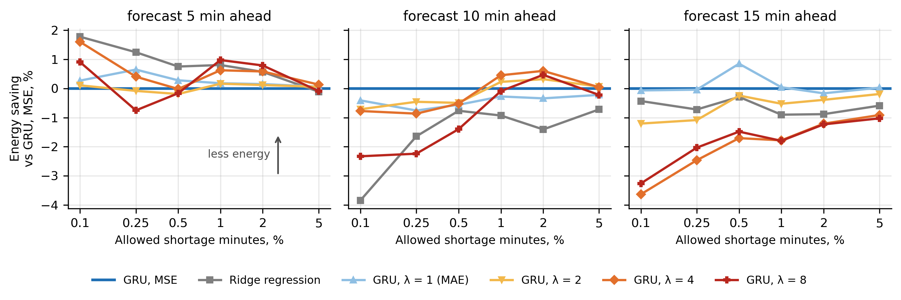

# dc-forecast-control

Code for the paper "Intelligent predictive control system for task placement and cooling in a data center"
(A. Marinenko, S. Vovk, Oles Honchar Dnipro National University, MPZIS-2026).

A data center hall can save energy if only the needed servers are on and the hall isn't overcooled.
But servers need time to start and cooling can't change its power instantly, so these decisions are
made in advance from a load forecast. Here a GRU forecasts the load 5-15 min ahead, and a simple
decision module sets the number of servers, puts tasks into the better-cooled zone first and prepares
cooling. The GRU is trained either with MSE or with an asymmetric loss that punishes underestimation
λ times more. Models are compared by the energy and reliability of the hall, not by forecast error.

## How to run

```bash
pip install -r requirements.txt

# 1. load series of 199 halls (20 machines each) from the Alibaba trace
wget http://aliopentrace.oss-cn-beijing.aliyuncs.com/v2018Traces/machine_usage.tar.gz -P data/
python scripts/01_build_series.py --trace data/machine_usage.tar.gz --out data/series.npz

# 2. train forecasters (repeat for --H 10 and --H 15)
python scripts/02_train_forecasts.py --series data/series.npz --H 5 --seeds 0,1,2,3,4,5,6,7,8,9 --out results/H5

# 3. decision module + hall simulator
python scripts/03_evaluate.py --run results/H5

# 4-5. statistics and figures
python scripts/04_report.py --runs results/H5 results/H10 results/H15 --out results/report
python scripts/05_figures.py --runs results/H5 results/H10 results/H15 --report results/report --out results/figures
```

Step 2 is much faster on a GPU. The whole thing is also in `notebooks/dc_forecast_control_kaggle.ipynb`,
which I ran on Kaggle (GPU T4, about 30 min, plus ~25 min if it builds the series from the raw trace). To just check that the code works, use
`01_build_series.py --synthetic` and `02_train_forecasts.py --max-series 20 --epochs 2`.

## Results

The notebook in `notebooks/` is saved with its outputs.
The final numbers are in `results/report/numbers.txt` (also `summary.json`) and the figures in `results/figures/`.

Main result (5 min ahead, shortage ≤ 1 %, overheating ≤ 0.1 %): the GRU trained with λ = 8 uses 0.98 %
less energy than the same GRU trained with MSE (better in 190 of 199 halls and in all 10 training runs).
When the reserves are tuned on validation and used on new data, it overheats the hall 26 times less often.



## Files

```
dccontrol/data.py        reading the trace, cleaning, grouping machines into halls
dccontrol/forecast.py    persistence, ridge, GRU, asymmetric loss
dccontrol/hall.py        decision module and the two-zone hall simulator
dccontrol/calibrate.py   choosing the server reserve m and the temperature setback s
scripts/01-05            the steps above
```

## Data

Alibaba cluster trace v2018, file `machine_usage.tar.gz` (1.7 GB):
https://github.com/alibaba/clusterdata/tree/master/cluster-trace-v2018

## Notes

- Each series is split in time: 60 % train, 20 % validation, 20 % test.
- The hall parameters (server 100-200 W, COP from Moore et al. 2005, 27 °C limit from ASHRAE) are
  reasonable values, not measurements of a real data center. The simulator is only used to compare
  forecasters under the same conditions.
